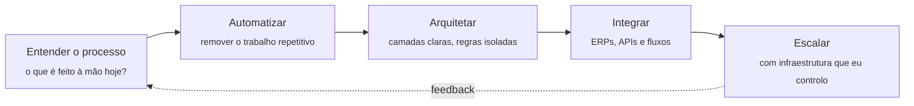

<!-- ═══════════════════════════════ HEADER ═══════════════════════════════ -->
<div align="center">


<a href="https://github.com/yyhago">
  
</a>

<br/>

[](https://www.linkedin.com/in/yhagofelipe/)
[](mailto:yhago.felipe.teles@gmail.com)


</div>

<!-- ═══════════════════════════════ WHOAMI ═══════════════════════════════ -->

## `$ whoami`

```ts
const yhago = {
  role:        "Desenvolvedor Full Stack",
  focus:       ["Arquitetura de Sistemas", "Integrações complexas", "Automação"],
  origin:      "Time de Cibersegurança — indústria farmacêutica",
  mindset:     "Automatizar antes de escalar",
  currently:   "Engenharia de Software @ Estácio",
  infra:       "Opero minha própria infraestrutura, do servidor ao deploy",
  openTo:      ["Novos desafios", "Colaborações", "Boas conversas sobre arquitetura"],
};
```

<!-- ═══════════════════════════════ STORY ═══════════════════════════════ -->

## Como cheguei aqui

Minha porta de entrada na tecnologia não foi um "Hello World" — foi o time de **Cibersegurança** de uma indústria farmacêutica. Ali, olhando processos manuais repetitivos, escrevi automações em Python que **reduziram em 40% o tempo dessas operações**.

Esse resultado mudou a forma como eu enxergo software: antes de escalar algo, vale perguntar *o que ainda está sendo feito à mão e não deveria*. Essa pergunta virou a base de como eu penso arquitetura até hoje.

Desde então, construí experiência sólida em **back-end e front-end**, com foco em **APIs RESTful bem arquitetadas** e no tipo de problema que costuma assustar: **fazer sistemas legados e ERPs conversarem entre si** sem que tudo vire gambiarra.

<!-- ═══════════════════════════════ IMPACT ═══════════════════════════════ -->

## Impacto em números

<div align="center">

| **-40%** | **3+ ERPs** | **100%** | **+20** |
|:---:|:---:|:---:|:---:|
| tempo em operações manuais com automações em Python | integrados em produção — OMIE, ERPFLEX e Datasul/TOTVS | da minha infraestrutura gerenciada por mim, do VPS ao proxy reverso | cursos em Full Stack, Cloud e DevOps, além de 3 certificações Azure |

</div>

<!-- ═══════════════════════════════ PHILOSOPHY ═══════════════════════════════ -->

## Como eu penso um sistema



<table>
<tr>
<td width="50%" valign="top">

### Arquitetura antes de atalho
Separação de responsabilidades e regras de negócio isoladas da infraestrutura. Código que outra pessoa consegue ler, testar e evoluir — inclusive eu, seis meses depois.

</td>
<td width="50%" valign="top">

### Integração sem medo
ERPs com documentação escassa, payloads inconsistentes e regras escondidas. É exatamente o tipo de problema que eu gosto de resolver.

</td>
</tr>
<tr>
<td width="50%" valign="top">

### Automação como padrão
Se uma tarefa se repete, ela vira fluxo. Uso orquestração de workflows para conectar sistemas e tirar pessoas de trabalho que não deveria ser delas.

</td>
<td width="50%" valign="top">

### Segurança no DNA
Vim da cibersegurança — então validação, princípio do menor privilégio e superfície de ataque entram na conversa desde o primeiro commit, não no último.

</td>
</tr>
</table>

<!-- ═══════════════════════════════ EDUCATION ═══════════════════════════════ -->

## Formação & Certificações

<details open>
<summary><b>Ver trajetória acadêmica</b></summary>
<br/>

| Formação | Instituição |
|---|---|
| **Engenharia de Software** *(em andamento)* | Centro Universitário Estácio de Sá |
| Técnico em **Desenvolvimento de Sistemas** | SENAI |
| Técnico em **Desenvolvimento de Sistemas** | ETEC |
| Bolsista — **Inglês técnico** | Programa Mackenzie CPM (Microsoft / SENAI) |

</details>

<details open>
<summary><b>Ver certificações</b></summary>
<br/>

<div align="center">


</div>

</details>

<!-- ═══════════════════════════════ GITHUB STATS ═══════════════════════════════ -->

## Atividade no GitHub

<div align="center">


<br/><br/>


<br/><br/>


<br/><br/>

<picture>
  <source media="(prefers-color-scheme: dark)" srcset="https://raw.githubusercontent.com/yyhago/yyhago/output/github-snake-dark.svg" />
  
</picture>

</div>

<!-- ═══════════════════════════════ CONTACT ═══════════════════════════════ -->

## Vamos conversar?

<div align="center">

Tem um sistema que precisa conversar com outro e ninguém sabe por onde começar?<br/>
Um processo manual que está segurando o crescimento do time?<br/>
Ou só quer trocar ideia sobre arquitetura e boas práticas?

**Me chama. É exatamente o tipo de conversa que eu gosto.**

<br/>

[](https://www.linkedin.com/in/yhagofelipe/)
[](mailto:yhago.felipe.teles@gmail.com)
[](https://github.com/yyhago)

</div>

<!-- ═══════════════════════════════ FOOTER ═══════════════════════════════ -->


